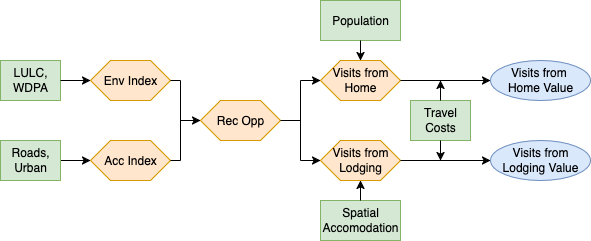

# Ecosystem Service Description

Recreation ecosystem services encompass the benefits people derive from engaging with natural environments for leisure, exercise, and tourism activities. We distinguish between two types of nature-based recreation: **Recreation from Home** represents visits to natural areas by local residents traveling from their homes, while **Recreation from Lodging** captures visits by tourists staying at accommodation facilities. Both forms of recreation depend critically on the quality and accessibility of natural ecosystems, generating substantial economic and social value through improved physical and mental health, cultural connections to nature, and tourism-related economic activity.

The valuation approach recognizes that high-quality natural environments, including forests, grasslands, protected areas, and water bodies, in combination with appropriate accessibility infrastructure create opportunities for meaningful human-nature interactions. These recreation opportunities generate measurable economic value through the time and travel costs people willingly incur to visit natural areas, reflecting their preferences for ecosystem-based recreation experiences.

Within the SEEA EA framework, this service corresponds to the final non-material recreation-related ecosystem services. It captures the direct contributions of ecosystems that enable individuals to experience, enjoy, and benefit from their natural surroundings. These benefits are realized through activities such as walking, wildlife observation, and nature-based tourism, in which ecosystems provide the setting and biophysical qualities essential for the experience itself. As a final ecosystem service, recreation represents the end point of ecosystem contributions before human use or enjoyment, linking ecological conditions directly to cultural, social, and economic well-being.
> "Recreation-related services are contributions of ecosystems, in particular through their biophysical characteristics and qualities, that enable people to use and enjoy the environment through direct, in situ, physical and experiential interactions with the environment. These include services both to locals and to non-locals (i.e. visitors, including tourists). Recreation-related services may also be supplied to those engaging in recreational fishing or hunting. These are final ecosystem services."
[@un2021seea]

# Methods

## Overview

The recreation valuation framework consists of three main steps, shown in @fig-overview. First, we map high-quality recreation areas using geospatial suitability analysis that combines environmental attractiveness with accessibility factors. Second, we apply a zonal travel cost method to estimate visit frequencies to these areas from both residents (recreation from home) and visitors (recreation from lodging). Finally, we calculate economic values using distance-based travel costs as a proxy for willingness to pay. The approach is builds on the European Commission's Integrated Natural Capital Accounting (INCA) framework [@Zulian2024].

{#fig-overview}

## Estimating Recreation Opportunity

The identification of recreation opportunities requires filtering observations to focus on areas that combine high natural quality with appropriate accessibility for recreational activities.

### Environmental Index

We quantify the intrinsic recreational attractiveness of different landscapes by assigning scores to land use/land cover (LULC) types based on their natural recreation appeal (ESA-CCI) [@ESA2017LandCoverCCI]. The environmental index combines weighted LULC shares with protected area status to create a composite measure of ecosystem-based recreation potential. Scores are adapted from the European CORINE Land Cover Data to fit the ESA-CCI Land Cover data [@Vallecillo2019196].

| LULC Class | Score |
|------------|-------|
| Cropland | 0.4 |
| Forest | 1.0 |
| Grassland | 0.7 |
| Other Natural | 0.85 |
| Water | 1.0 |
| Urban | 0.05 |
| Other | 0.0 |
| Protected Areas | 1.0 |

: Environmental Index Scores {#tbl-environmental}

The environmental index is calculated as:

$$\text{Environmental Score} = \sum(\text{LULC share} \times \text{LULC score}) + (\text{Protected Area share} \times 1.0)$$

Areas are then classified into four environmental quality categories (0-3) based on combined scores, where higher values indicate greater natural recreation potential.

### Accessibility Index

We measure accessibility to recreational opportunities by combining road network density (GRIP4) [@Meijer2018] and urban development levels (urban share ESA-CCI LULC) [@ESA2017LandCoverCCI]. This index captures how built infrastructure enables recreation access, recognizing that both roads and urban services are essential for facilitating nature-based recreation.

| Category | Share of Urban | Road Density (m/km²) |
|----------|----------------|----------------------|
| High | (0.9, 1) | (100000, ∞) |
| Medium-High | (0.5, 0.9] | (33819, 100000] |
| Medium | (0.1, 0.5] | (13326, 33819] |
| Medium-Low | (0.001, 0.1] | (5453, 13326] |
| Low | [0, 0.001) | [0, 5453) |

: Accessibility Index Thresholds {#tbl-accessibility}

| Urban Score | Low | Medium-Low | Medium | Medium-High | High |
|-------------|-----|------------|--------|-------------|------|
| **Low** | 1 | 1 | 2 | 3 | 4 |
| **Medium-Low** | 1 | 1 | 2 | 3 | 4 |
| **Medium** | 2 | 2 | 2 | 4 | 5 |
| **Medium-High** | 3 | 3 | 4 | 5 | 5 |
| **High** | 3 | 4 | 5 | 5 | 5 |

: Urban-Road Accessibility Matrix (columns represent Road Score) {#tbl-urban-road}

### High-Quality Area Identification

We combine environmental and accessibility indices using a matrix approach to create a comprehensive ranking of recreation areas. This classification system balances natural attractiveness with accessibility needs to identify areas with different recreation potential.

| Environmental Score | Low | Medium-Low | Medium-High | High |
|---------------------|-----|------------|-------------|------|
| **Low** | 1 | 1 | 4 | 7 |
| **Medium-Low** | 1 | 4 | 4 | 7 |
| **Medium** | 2 | 2 | 8 | 8 |
| **Medium-High** | 3 | 5 | 5 | 9 |
| **High** | 3 | 6 | 6 | 9 |

: Recreation Area Ranking (columns represent Accessibility Score) {#tbl-ranking}

Areas scoring 9 in the ranking are identified as high-quality recreation sites, representing locations that combine high natural value with appropriate accessibility for recreation activities.

## Recreation from Home Analysis

### Visit Estimation (Zonal Travel Cost Model)

Recreation from home visits are estimated using a zonal travel cost approach where visit frequency decreases with travel distance to high-quality recreation areas. The model uses gridded population data (Worldpop) [@WorldPopUnconstrainedGlobalMosaics2000_2020] and applies distance-decay functions calibrated from the UK's Monitor of Engagement with the Natural Environment (MENE) study and used in the INCA method [@NaturalEngland2016MENE].

$$N = \sum_{i=1}^4 \frac{(1+k_i)}{(k_i + e^{-\alpha_i \times \text{Pop}_i})}$$

where $N$ represents the number of weekly visits flowing into a high-quality recreation site, measured in 1km grid cells. To get annual estimates, the result is multiplied by 52.

| Distance Band | $k_i$ | $\alpha_i$ |
|---------------|-------|------------|
| Distance 1 (<1 km) | 0.0132 | 0.00155 |
| Distance 2 (1–2 km) | 0.0267 | 0.00115 |
| Distance 3 (2–3 km) | 0.0518 | 0.00098 |
| Distance 4 (3–4 km) | 0.1067 | 0.00067 |

: Mobility Function Parameters {#tbl-mobility}

### Economic Valuation

The economic value of recreation from home is estimated using the travel cost method, where the cost of traveling to recreation sites serves as a proxy for willingness to pay. Values are calculated as:

$$\text{Annual Value} = \text{Annual Visits} \times c_i \times \text{Travel Cost per Visit}$$

The travel cost $c_i$ is based on average fuel costs per kilometer, assumed to be equal within a country [@GlobalPetrolPrices2025; @IEA2020FuelPrices; @IEA2021GFEI]. This assumes that the mode of transportation comes through ground transportation using motor vehicles. We estimate the value of these visits based on the travel cost incurred by visits to high-quality recreation areas.

## Recreation from Lodging Analysis

### Visitor Location Modeling

Recreation from lodging demand is modeled by spatially allocating national overnight stay statistics using accommodation infrastructure as a proxy for visitor distribution. We combine:

- **National Tourism Data**: UNWTO annual overnight stay statistics (domestic and international) [@UNWTO2023]
- **Accommodation Infrastructure**: Delta Check georeferenced hotel and accommodation points [@DeltaCheck2023]

This generates country-level overnight stays distributed proportionally to hotel density.

### Visits Estimation (Zonal Travel Cost)

Recreation from lodging visits to high-quality recreation sites are estimated using the same zonal travel cost framework as recreation from home, but with overnight stay data as the population proxy instead of residential population. This approach assumes that visitors at lodging facilities visit recreation sites based on their accommodation location, with visit probability decreasing with distance.

### Economic Valuation

We estimate the economic value using the same zonal travel cost framework as recreation from home, but with overnight stay data as the population proxy instead of residential population. These estimates capture only the value represented by local travel costs and do not capture international travel or other expenditures that may be related to nature-based tourism.

## Variables and Datasets

| Variable | Dataset | Source | Resolution |
|----------|---------|--------|------------|
| Land Cover | ESA-CCI Land Cover | [@ESA2017LandCoverCCI] | 300m |
| Protected Areas | World Database on Protected Areas (WDPA) | [@UNEPWCMC_WDPA] | Vector |
| Road Network Density | GRIP4 Global Roads Dataset | [@Meijer2018] | Vector |
| Population | WorldPop Constrained Population | [@WorldPopUnconstrainedGlobalMosaics2000_2020] | 1km |
| Tourism Statistics | Annual Overnight Stays | [@UNWTO2023] | Country-level |
| Accommodation Points | Delta Check Hotel Database | [@DeltaCheck2023] | Point locations |
| Fuel Costs | Country Fuel Price Data | [@GlobalPetrolPrices2025; @IEA2020FuelPrices; @IEA2021GFEI] | Country-level |

: Key Variables and Datasets {#tbl-datasets}

# Validation

[Validation in progress]

# Areas for Improvement

## Estimating Recreation Opportunity

The categories used for identifying areas for recreation potential, including the environmental inde and accessibility index, need additional validation from the literature. 

## Zonal Travel Cost Model

The zonal travel cost method relies heavily on the values for $k_i$ and $\alpha_i$, sourced from he UK’s Monitor of Engagement with the Natural Environment (MENE) [@NaturalEngland2016MENE]. The assumption implies that recreation preferences are consistent across the globe, for both residents and visitors, which is unlikely. The recreation team is researching ways to improve this measure. Specifically, the approach may be to rely on one of the scaling laws of human mobility to handle global values for $k_i$ and $\alpha_i$ [@Hooftman2023110779].


# Results

```{python}
#| echo: false
#| warning: false
#| label: imports

import geopandas as gpd
import matplotlib.pyplot as plt
from matplotlib.ticker import FuncFormatter
import pandas as pd
from IPython.display import Markdown
from tabulate import tabulate
```

```{python}
#| echo: false
#| warning: false
#| label: load-results

# Read the country-level results
gdf = gpd.read_file("/Users/mbraaksma/Files/gep_recreation/projects/global_recreation_results/intermediate/aggregate_results_iso3/results_by_country.gpkg")

# Drop Antarctica for clarity
gdf = gdf[gdf['iso3_r250_label'] != 'ATA']

# Rename columns for clarity
gdf = gdf.rename(columns={
    'daily_visits': 'home_visits',
    'daily_value': 'home_value',
    'tourist_visits': 'lodging_visits',
    'tourist_value': 'lodging_value'
})

# Calculate combined totals
gdf['total_visits'] = gdf['home_visits'] + gdf['lodging_visits']
gdf['total_value'] = gdf['home_value'] + gdf['lodging_value']
```

## Spatial Distribution of Recreation Values

```{python}
#| echo: false
#| warning: false
#| fig-cap: "Global Recreation from Home Visits"
#| label: fig-home-visits

def format_cbar_with_commas(ax):
    """Format colorbar with comma separators"""
    cbar = ax.get_figure().axes[-1]
    cbar.yaxis.set_major_formatter(FuncFormatter(lambda x, _: f"{int(x):,}"))

# Recreation from Home Visits
fig, ax = plt.subplots(1, 1, figsize=(14, 7))
gdf.plot(column="home_visits", ax=ax, legend=True, cmap="Blues", 
         edgecolor='none', legend_kwds={'shrink': 0.5})
ax.set_title("Global Recreation from Home Visits", fontsize=16, fontweight='bold')
ax.set_axis_off()
format_cbar_with_commas(ax)
plt.tight_layout()
plt.show()
```

```{python}
#| echo: false
#| warning: false
#| fig-cap: "Global Recreation from Home Value (USD)"
#| label: fig-home-value

fig, ax = plt.subplots(1, 1, figsize=(14, 7))
gdf.plot(column="home_value", ax=ax, legend=True, cmap="Greens", 
         edgecolor='none', legend_kwds={'shrink': 0.5})
ax.set_title("Global Recreation from Home Value (USD)", fontsize=16, fontweight='bold')
ax.set_axis_off()
format_cbar_with_commas(ax)
plt.tight_layout()
plt.show()
```

```{python}
#| echo: false
#| warning: false
#| fig-cap: "Global Recreation from Lodging Visits"
#| label: fig-lodging-visits

fig, ax = plt.subplots(1, 1, figsize=(14, 7))
gdf.plot(column="lodging_visits", ax=ax, legend=True, cmap="Blues", 
         edgecolor='none', legend_kwds={'shrink': 0.5})
ax.set_title("Global Recreation from Lodging Visits", fontsize=16, fontweight='bold')
ax.set_axis_off()
format_cbar_with_commas(ax)
plt.tight_layout()
plt.show()
```

```{python}
#| echo: false
#| warning: false
#| fig-cap: "Global Recreation from Lodging Value (USD)"
#| label: fig-lodging-value

fig, ax = plt.subplots(1, 1, figsize=(14, 7))
gdf.plot(column="lodging_value", ax=ax, legend=True, cmap="Greens", 
         edgecolor='none', legend_kwds={'shrink': 0.5})
ax.set_title("Global Recreation from Lodging Value (USD)", fontsize=16, fontweight='bold')
ax.set_axis_off()
format_cbar_with_commas(ax)
plt.tight_layout()
plt.show()
```

```{python}
#| echo: false
#| warning: false
#| fig-cap: "Global Combined Recreation Visits"
#| label: fig-total-visits

fig, ax = plt.subplots(1, 1, figsize=(14, 7))
gdf.plot(column="total_visits", ax=ax, legend=True, cmap="Blues", 
         edgecolor='none', legend_kwds={'shrink': 0.5})
ax.set_title("Global Combined Recreation Visits", fontsize=16, fontweight='bold')
ax.set_axis_off()
format_cbar_with_commas(ax)
plt.tight_layout()
plt.show()
```

```{python}
#| echo: false
#| warning: false
#| fig-cap: "Global Combined Recreation Value (USD)"
#| label: fig-total-value

fig, ax = plt.subplots(1, 1, figsize=(14, 7))
gdf.plot(column="total_value", ax=ax, legend=True, cmap="Greens", 
         edgecolor='none', legend_kwds={'shrink': 0.5})
ax.set_title("Global Combined Recreation Value (USD)", fontsize=16, fontweight='bold')
ax.set_axis_off()
format_cbar_with_commas(ax)
plt.tight_layout()
plt.show()
```

## Results by Country

```{python}
#| label: tbl-country-results
#| tbl-cap: "Country-Level Recreation Results (Sorted by Total Value)"
#| echo: false
#| warning: false

# Create summary table
summary_df = gdf.drop(columns='geometry')[[
  'iso3_r250_label', 
  'home_visits', 
  'home_value',
  'lodging_visits', 
  'lodging_value', 
  'total_visits', 
  'total_value']]

# Sort by total value
summary_df = summary_df.sort_values('total_value', ascending=False)

# Rename columns for display
summary_df = summary_df.rename(columns={
    'iso3_r250_label': 'Country',
    'home_visits': 'Recreation from Home Visits',
    'home_value': 'Recreation from Home Value (USD)',
    'lodging_visits': 'Recreation from Lodging Visits',
    'lodging_value': 'Recreation from Lodging Value (USD)',
    'total_visits': 'Total Visits',
    'total_value': 'Total Value (USD)'
})

# Format large numbers
for col in summary_df.columns[1:]:
    summary_df[col] = summary_df[col].apply(lambda x: f"{x:,.0f}")

# Display using markdown for better Word compatibility
Markdown(tabulate(summary_df, headers='keys', tablefmt='pipe', showindex=False))
```


# References

[References to be added]